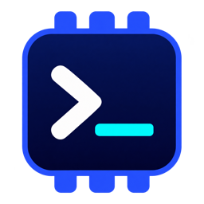

# dsh-remote-dc

English · [简体中文](README.md)



**Campus or office server unreachable from the public internet? Give Remote DC a try.**

Need to read experiment logs from off campus or check a build on your office server from home? Run the Desktop Commander agent on a machine you're authorized to use, then sign in to the same account in DeepSeek Harness. If the machine can connect outbound to Desktop Commander's service, you can find files, read logs, edit documents, and work in a terminal from a dsh conversation. Account mode needs no public IP, inbound port, or SSH service on the target machine.

## Installation

Requires **dsh 0.2.2-rc.1 or later**. The standalone CLI requires Node.js 24.9 or later on the dsh host.

In the desktop app, open **Plugins → Install existing plugin** and enter `dsh-remote-dc@0.1.0`. For the Web profile, run:

```sh
dsh plugin --profile web add dsh-remote-dc@0.1.0
```

You can also download the tarball and run the following command from its directory. [GitHub v0.1.0 Release](https://github.com/lonelycrab888/dsh-remote-dc/releases/tag/v0.1.0)

```sh
dsh plugin --profile web add ./dsh-remote-dc-0.1.0.tgz
```

## Connect your account and pair a device

1. Open **Settings → Remote Desktop Commander → Connect account → Open authorization page**. Complete the Desktop Commander sign-in and authorization in a browser on the computer running dsh.
2. Run the following command on the target machine. Use the same Desktop Commander account to verify the pairing code, then leave the device agent running.

   ```sh
   npx @wonderwhy-er/desktop-commander@latest remote
   ```

3. Return to Settings and refresh the device list. In a conversation, try “Use Remote Desktop Commander to show me the latest log in `/home/me/experiments` on the experiment server.”

**Manage and pair devices** in Settings opens the official dashboard, where you can check device status, add a machine, or revoke access. If a device appears offline, check that its agent is still running and that it has outbound network access. [Official pairing guide](https://github.com/desktop-commander/remote-desktop-commander/blob/main/docs/SETUP.md)

## Account tools and credentials

- The plugin discovers the tools the official MCP server exposes to your account, including file operations, search, terminal sessions, device management, account information, and call history. It registers their upstream schemas in dsh and forwards parameters such as `deviceId`. For example, `mcp__remote_desktop_commander__list_devices` lists paired machines. Available tools depend on your account and device permissions.
- dsh saves the OAuth grant in its credential store and restores it across restarts. Settings shows the connection status, tool count, and device information returned by the service. The plugin attempts to refresh expired access tokens and offers a reconnect action when authorization is required.
- **Disconnect** removes the grant from dsh and unloads the account's tools. Use the official dashboard to revoke authorization or unpair a device on the Desktop Commander side. [Desktop Commander dashboard](https://mcp.desktopcommander.app/)
- The Codex plugin and dsh connect to the same official service. dsh applies its own host-level tool permissions and review flows. [Remote Desktop Commander for Codex](https://openai.com/business/plugins/remote-desktop-commander/)

## Optional local and SSH modes

1. Install Desktop Commander on each target machine. These modes require Node.js 22.12 or later on the target. This integration was tested with Desktop Commander 0.3.3.

   ```sh
   npm install --global @wonderwhy-er/desktop-commander@0.3.3
   command -v desktop-commander
   ```

2. For SSH mode, configure an OpenSSH host alias on the dsh machine. Replace the example host, username, and key path with your own. Verify the server's host key through a trusted channel and record it in `known_hosts`.

   ```sshconfig
   Host dsh-workstation
       HostName workstation.example.org
       User dc
       IdentityFile ~/.ssh/dsh_workstation_ed25519
       IdentitiesOnly yes
   ```

   ```sh
   ssh -T -o BatchMode=yes -o StrictHostKeyChecking=yes dsh-workstation 'command -v desktop-commander'
   ```

   If the non-interactive session cannot find Node.js, configure its `PATH` or point `executable` to a launcher that uses the absolute path to Node.js. Configure the SSH key through OpenSSH or unlock it with `ssh-agent`. For local mode, continue to step 3.

3. Install the plugin using the instructions above. The device list starts empty. Copy the sample configuration to `rdc.patch.yml`, fill in the device details, and set `enabled: true` on each device you want to use. Load the file as a temporary overlay. [Sample device configuration](examples/devices.patch.yml)

   ```sh
   dsh --profile web --patch ./rdc.patch.yml
   ```

   To make the configuration persistent, merge the sample entry into `${DSH_HOME:-$HOME/.dsh}/profiles/web/cordis.patch.yml` and restart the profile. If an entry with the same ID already exists, update its `config.devices` field.

4. Check the device status in a conversation. For example, “Use `remote_dc_list_devices` to list devices, then use Desktop Commander on `workstation` to list the first level of `/home/dc/projects`.”

A minimal local configuration is shown below. If dsh cannot find `desktop-commander` on its `PATH`, set `executable` to the absolute path returned by `command -v desktop-commander`.

```yaml
- id: remote-dc
  config:
    devices:
      local:
        transport: local
        access: read
```

### Tools and access modes

| Mode | Capabilities |
| --- | --- |
| `read` (default) | List directories, inspect file metadata, read one or more files, and start, page through, or cancel searches |
| `write` | Adds directory creation, writing and appending, exact block edits, moves, and PDF editing |
| `shell` | Adds process launch, output polling, interactive input, session and process listing, and termination |

Each device registers tools under `mcp__rdc_<device_id>__<tool_name>`, such as `mcp__rdc_workstation__read_file`. Use absolute paths on the target and keep search IDs and process IDs within the device's namespace. An MCP reconnect starts a new backend process, so previous IDs expire. The upstream PDF generator may require Chrome on the target.

| Field | Meaning |
| --- | --- |
| Device ID | Up to 24 characters. Starts with a lowercase letter and can contain lowercase letters, digits, and underscores. |
| `transport` | `ssh` or `local` |
| `sshHost` | Required in SSH mode. Matches a `Host` alias in the local OpenSSH configuration. |
| `sshConfig` | Optional absolute path to a local OpenSSH configuration file |
| `executable` | Absolute path on the target. Defaults to `desktop-commander` on the target's `PATH`. |
| `cwd` | Optional target working directory. SSH commands use a POSIX-compatible login shell. |
| `enabled` | Defaults to `true`. Set it to `false` to disable the device. |
| `startupTimeoutMs` and `toolCallTimeoutMs` | Defaults to 20 seconds and 60 seconds, respectively |

### Local and SSH permissions

SSH uses batch mode and strict host-key verification. Forwarding and connection sharing are disabled. The SSH mode opens no public listening port. The plugin applies the tool allowlist during both discovery and execution. Configuration changes, feedback, upstream usage statistics, and recent-call queries are excluded. File reads use paths on the target device. The plugin disables upstream telemetry via an environment variable. Desktop Commander can still fetch feature configuration, keep local call logs, and use runtime dependencies for features such as PDF generation.

`access` controls which tools dsh can call. The target account's operating-system permissions and Desktop Commander's file settings control data access. In `shell` mode, commands and process operations run with the target account's privileges. `cwd` sets the starting directory. Use operating-system or container permissions to scope accessible files and processes. dsh sessions may record tool arguments and results.

If a connection fails, check the dsh startup logs and test the host alias with SSH. SSH must be able to launch the upstream program directly, with stdout reserved for MCP messages. dsh reconnects after temporary interruptions. To disable a device, set `enabled: false` and restart the profile. To uninstall the plugin from the Web profile, run:

```sh
dsh plugin --profile web remove dsh-remote-dc
```

## Upstream projects and credits

- The **Desktop Commander team** provides the official Remote MCP service, device agent, and remote file, search, and terminal tools. dsh-remote-dc is an independent integration for DeepSeek Harness that connects to the official Streamable HTTP endpoint using OAuth 2.0 with PKCE. [Desktop Commander](https://desktopcommander.app/) · [Remote Desktop Commander](https://github.com/desktop-commander/remote-desktop-commander) · [Desktop Commander local MCP](https://github.com/wonderwhy-er/DesktopCommanderMCP)
- The plugin icon takes inspiration from the chip outline of the official Remote MCP icon and adds blue pins and a terminal prompt. [Official icon and MCP manifest](https://github.com/desktop-commander/remote-desktop-commander/blob/main/server.json)

## Implementation and tests

- `src/account.js` connects to the official MCP service, registers tools, refreshes credentials, and manages the connection. `src/oauth.js` uses the MCP SDK for browser authorization and the local callback.
- `src/client.cjs` registers the dsh Settings page. `src/settings-route.js` exposes account operations through dsh's authenticated host API.
- `npm test` covers OAuth, PKCE, state validation, token refresh, and SSH mode. `npm run test:dsh` installs the tarball in a temporary profile and verifies the OAuth callback, MCP tool discovery, device argument forwarding, token rotation, account restoration, and uninstall.
