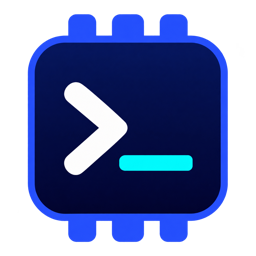

# dsh-remote-dc



**学校或公司内网的服务器在公网无法访问？快试试 Remote DC。**

在校外也想看实验日志，或想在家确认公司服务器上的构建结果？在有权使用的目标机器上运行 Desktop Commander 代理，再从 DeepSeek Harness 登录同一个账户。设备能够出站连接官方服务时，你就能在 dsh 对话里找文件、读日志、编辑文档或操作终端。账户模式无需在目标机器上配置公网 IP、开放入站端口或安装 SSH 服务。

## 安装

兼容 **dsh 0.2.2-rc.1 及以上**。使用独立 CLI 时，宿主需要 Node.js 24.9 或以上。

桌面端打开 **插件 → 安装已有插件**，输入 `dsh-remote-dc@0.1.0`。Web profile 也可以用命令安装。

```sh
dsh plugin --profile web add dsh-remote-dc@0.1.0
```

也可从 [GitHub v0.1.0 Release](https://github.com/lonelycrab888/dsh-remote-dc/releases/tag/v0.1.0) 下载安装包，在包所在目录运行以下命令。

```sh
dsh plugin --profile web add ./dsh-remote-dc-0.1.0.tgz
```

## 连接账户与配对设备

1. 打开 **设置 → Remote Desktop Commander → 连接账户 → 打开授权页面**。在运行 dsh 的电脑上，用浏览器完成 Desktop Commander 登录与授权。
2. 在目标设备运行下方命令。用同一个 Desktop Commander 账户核对配对码，并让设备代理保持运行。

   ```sh
   npx @wonderwhy-er/desktop-commander@latest remote
   ```

3. 回到设置页刷新设备列表。在对话里试一句「用 Remote Desktop Commander 查看实验服务器上 `/home/me/experiments` 目录的最新日志。」

设置页的 **管理与配对设备** 会打开官方控制台，可查看设备状态、添加设备或撤销访问。如果设备处于离线状态，检查目标机器上的代理进程和出站网络。[官方配对指南](https://github.com/desktop-commander/remote-desktop-commander/blob/main/docs/SETUP.md)

## 账户工具和凭据

- 文件、搜索、终端、设备管理、账户和调用记录等能力由官方 MCP 向当前账户公布。插件按原始 schema 动态注册这些工具，例如 `mcp__remote_desktop_commander__list_devices`，并将选择设备所需的 `deviceId` 等参数照常传给服务。工具可用性随上游账户和设备权限变化。
- OAuth grant 保存在 dsh 宿主的凭据存储中，跨重启恢复。设置页仅显示连接状态、已加载工具数和上游返回的设备信息。访问令牌失效时，插件尝试刷新。需要用户授权时，设置页显示重新连接入口。
- **断开连接** 删除 dsh 中的授权凭据并卸载该账户的工具。要在 Desktop Commander 侧撤销授权或配对，请使用其官方控制台。
- [Codex 插件](https://openai.com/business/plugins/remote-desktop-commander/) 的宿主工具审核与权限界面由 OpenAI 提供。dsh 接入同一官方服务，并使用 dsh 自身的工具与权限界面。

## 可选的本机与 SSH 模式

1. 在每台被访问的电脑上安装 Desktop Commander，远端需要 Node.js 22.12+。上游独立升级，本版本使用 0.3.3 验证。

   ```sh
   npm install --global @wonderwhy-er/desktop-commander@0.3.3
   command -v desktop-commander
   ```

2. 在运行 dsh 的电脑上，为远端配置一个 OpenSSH 主机别名。以下配置中的主机名、账号和密钥路径按实际情况填写。先通过可信渠道确认服务器的主机密钥并保存到 `known_hosts`。

   ```sshconfig
   Host dsh-workstation
       HostName workstation.example.org
       User dc
       IdentityFile ~/.ssh/dsh_workstation_ed25519
       IdentitiesOnly yes
   ```

   ```sh
   ssh -T -o BatchMode=yes -o StrictHostKeyChecking=yes dsh-workstation 'command -v desktop-commander'
   ```

   若命令在非交互会话中找不到 Node.js，配置远端的非交互 PATH，或将 `executable` 指向使用 Node.js 绝对路径的启动脚本。SSH 密钥使用系统配置或由 ssh-agent 解锁。只访问本机时无需此步骤。

3. 按上文安装插件。默认安装时设备列表为空。将 [设备配置示例](examples/devices.patch.yml) 另存为 `rdc.patch.yml`，填写设备并把相应的 `enabled` 改为 `true`。初次运行可以使用临时 overlay。

   ```sh
   dsh --profile web --patch ./rdc.patch.yml
   ```

   也可将示例的 YAML 条目合并到 `${DSH_HOME:-$HOME/.dsh}/profiles/web/cordis.patch.yml`，重启该 profile。已有同 ID 的条目时，更新其 `config.devices`。

4. 在会话里先确认设备状态，例如「用 remote_dc_list_devices 列出设备。用 workstation 上的 Desktop Commander 列出 /home/dc/projects 的第一层目录。」

本机最小配置如下。若 dsh 的 PATH 找不到 `desktop-commander`，填写安装命令返回的绝对路径。

```yaml
- id: remote-dc
  config:
    devices:
      local:
        transport: local
        access: read
```

### 工具与访问模式

| 模式 | 提供的能力 |
| --- | --- |
| `read`，默认 | 目录列表、文件元数据、单个或多个文件读取、后台搜索、分页和取消 |
| `write` | 增加创建目录、写入或追加、精确块编辑、移动和 PDF 编辑 |
| `shell` | 增加进程启动、输出读取、交互输入、会话与进程列表、终止 |

每台设备独立注册 `mcp__rdc_<设备ID>__<工具名>`。例如 `mcp__rdc_workstation__read_file`。使用目标设备上的绝对路径，并在同一个设备命名空间下消费搜索会话或进程 PID。MCP 重新连接后由新的后端进程提供会话，旧会话 ID 和 PID 不可复用。PDF 输出由上游实现，生成 PDF 可能需要远端 Chrome。

| 字段 | 用法 |
| --- | --- |
| 设备 ID | 小写英文字母开头，可带小写字母、数字和下划线，总长最多 24 |
| `transport` | `ssh` 或 `local` |
| `sshHost` | SSH 模式必填，匹配本机 ssh_config 的 Host 别名 |
| `sshConfig` | 可选，本机 OpenSSH 配置文件的绝对路径 |
| `executable` | 目标设备上的绝对路径，默认在其 PATH 中查找 `desktop-commander` |
| `cwd` | 可选，目标设备上的工作目录。SSH 命令使用 POSIX 兼容登录 shell |
| `enabled` | 默认为 `true`，设为 `false` 会停用设备 |
| `startupTimeoutMs` / `toolCallTimeoutMs` | 默认 20 秒 / 60 秒 |

### 本机与 SSH 的运行权限

SSH 连接使用批处理模式、严格的主机密钥验证，并关闭转发和 SSH 连接复用。SSH 模式不启动公网监听端口。允许的工具同时在发现和调用阶段校验。工具集合排除配置修改、反馈、上游用量查询和最近调用记录。文件读取提供设备文件路径。上游遥测通过环境变量关闭，上游仍可获取功能配置、保留本地调用记录，以及在提供 PDF 等功能时使用其运行依赖。

`access` 限制 dsh 可调用的工具。数据访问由目标账号的操作系统权限和 Desktop Commander 的文件工具配置决定。特别是 `shell` 模式能在目标设备上按登录用户权限运行命令和管理进程，`cwd` 仅设置启动目录。用目标账号或容器的权限控制可触达的文件和进程。dsh 会话也可能记录工具参数及返回内容。

连接失败时，检查 dsh 启动日志及用 SSH 测试该别名。SSH 会话需能直接执行上游程序，登录脚本需要保持标准输出留给 MCP。临时断开时 dsh 会自动重连。要停用设备，将 `enabled` 设为 `false` 并重启 profile。卸载整个插件可运行：

```sh
dsh plugin --profile web remove dsh-remote-dc
```

## 上游项目与致谢

- **Desktop Commander 团队**提供官方 Remote MCP、设备配对代理和文件、搜索、终端等远程工具。dsh-remote-dc 是面向 DeepSeek Harness 的独立集成，通过官方 Streamable HTTP 端点和 OAuth 2.0 + PKCE 连接账户。[Desktop Commander 官方网站](https://desktopcommander.app/) · [Remote Desktop Commander](https://github.com/desktop-commander/remote-desktop-commander) · [Desktop Commander 本机 MCP](https://github.com/wonderwhy-er/DesktopCommanderMCP)
- 新图标参考官方 Remote MCP 图标的芯片轮廓，以蓝色引脚和终端符号重新设计。[官方图标及 MCP 清单](https://github.com/desktop-commander/remote-desktop-commander/blob/main/server.json)

## 实现和验证

- `src/account.js` 连接官方 MCP 服务、注册上游工具、刷新凭据和管理连接。`src/oauth.js` 使用 MCP SDK 驱动浏览器 OAuth 和本机回调。
- `src/client.cjs` 注册 dsh 设置页。`src/settings-route.js` 通过 dsh 已认证的宿主接口提供账户操作。
- `npm test` 检查 OAuth、PKCE、状态校验、刷新和旧版 SSH 模式。`npm run test:dsh` 使用临时 profile 安装 tarball、验证 OAuth 登录回调、MCP 工具发现、设备参数透传、令牌轮换、账号恢复和插件卸载。
